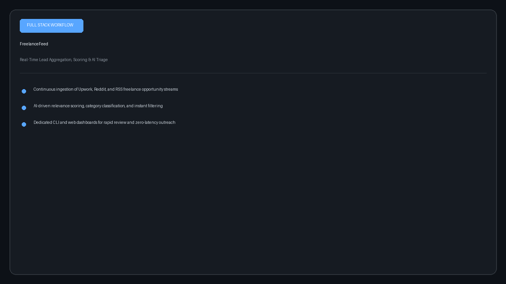

# FreelanceFeed

> **Real-time client lead aggregation, relevance scoring, and zero-latency outreach triage.**

[](media/walkthrough.mp4)

*Click the preview card above to watch the technical walkthrough.*

---

## Why I Built This

Browsing freelance platforms manually is a full-time job of sorting through low-budget spam, vague RFPs, and agency bait. By the time a high-fit posting hits page 3 of search results, 50 applicants have already submitted generic proposals.

FreelanceFeed connects directly to live RSS feeds, Reddit developer boards, and API endpoints, normalizes disparate post schemas into a structured lead stream, and scores each opportunity against your exact technical stack and hourly rate targets.

## Standout Features

- **Multi-Source Polling:** Continuous async polling of Upwork client RSS feeds, `/r/forhire`, and remote job boards with configurable jitter.
- **Keyword & Rate Triage:** Rule-based and LLM-assisted filtering that flags high-value contracts and discards below-threshold postings.
- **Fast CLI & Web Dashboards:** Review incoming leads, preview client history, and open direct application URLs with keyboard hotkeys.

## Visuals & Pipeline

| Lead Triage Interface | Pipeline Architecture |
| :--- | :--- |
|  |  |

Watch the complete pipeline explainer: **[media/walkthrough.mp4](media/walkthrough.mp4)**.

## Local Setup

```bash
git clone https://github.com/Invictine/freelancefeed.git
cd freelancefeed

python -m venv venv
source venv/bin/activate  # On Windows: venv\Scripts\activate
pip install -r requirements.txt

# Launch the feed listener and web UI
python main.py
```
